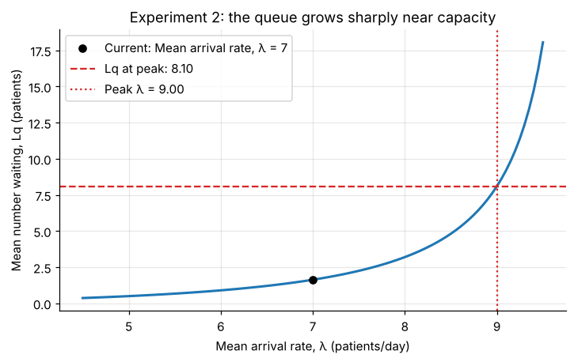
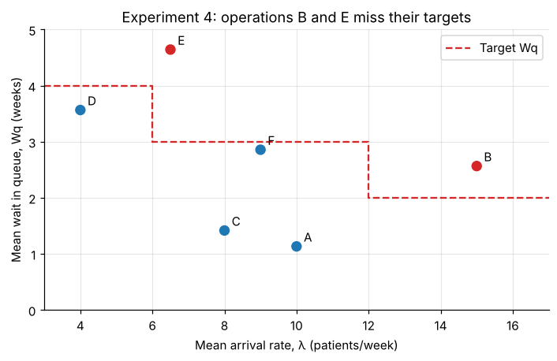

# Healthcare Queueing Models

[](https://github.com/joeyereiei/healthcare-queueing-models/actions/workflows/tests.yml)


A Python toolkit for the **M/M/1, M/G/1 and M/M/s** queuing models, applied to six capacity-planning questions across emergency, outpatient, surgical and laboratory services.

📓 **[Open the notebook](healthcare_queuing_models.ipynb)**: the full write-up, with the models, code, tests, results and discussion.

## Results

| # | Model | Setting | Question | Answer |
|---|---|---|---|---|
| 1 | M/M/1 | Emergency department | Service rate for a mean wait under 30 min | μ ≥ 5.46 patients/hour (+21%) |
| 2 | M/M/1 | Allergy clinic | Queue length if demand rises from 7 to 9/day | 1.63 → 8.10 patients waiting |
| 3 | M/G/1 | Surgery (CV = 2) | Maximum demand for a mean wait under 4 weeks | λ ≤ 21.39/week (97% utilisation) |
| 4 | M/G/1 | Surgery | Operation types missing their wait targets | B and E |
| 5 | M/M/s | Phlebotomy | Staff for a mean wait under 1 min | 38 phlebotomists |
| 6 | M/M/s | Phlebotomy | Staff for < 40 patients present 90% of the time | 37 phlebotomists |

**Waiting rises steeply near capacity.** At the allergy clinic, a 29% rise in demand makes the queue five times longer:



**Variable treatment times matter as much as busy servers.** Operation B misses its target at only 79% utilisation, because its procedure times are highly variable:



## Quick start

```bash
git clone https://github.com/joeyereiei/healthcare-queueing-models.git
cd healthcare-queueing-models
pip install -r requirements.txt
jupyter notebook healthcare_queuing_models.ipynb
```

```python
import pandas as pd
from queuing_models import Queue, find_parameter

# One scenario
Queue("mms").experiment(lambd=2, mu=3, s=2).report()

# Many scenarios at once; label columns are kept
q = Queue("mg1")
q.experiment_df(pd.DataFrame({"operation": ["A", "B"], "lambd": [10, 15],
                              "mu": [15, 19], "cv": [4, 5]}))

# Solve exactly for the parameter that meets a target
find_parameter("mm1", "mu", "Wq", target=0.5, lower=4.01, upper=10, lambd=4)  # 5.464
```

Invalid inputs and unstable queues (ρ ≥ 1) raise an `InvalidParameterError` with an explanation. To record unstable rows in a sweep instead, pass `experiment_df(..., on_unstable="flag")`.

## Repository structure

```
├── healthcare_queuing_models.ipynb   # Write-up: models, tests, six experiments, discussion
├── queuing_models/
│   ├── exceptions.py                 # InvalidModelError, MissingColumnsError, InvalidParameterError
│   ├── validation.py                 # validate_params(): value and steady-state checks
│   ├── formulas.py                   # compute_rho, compute_Lq, compute_p, compute_metrics, ...
│   └── queue.py                      # Queue class and find_parameter()
├── tests/test_queuing_models.py      # pytest suite
├── figures/                          # Figures exported from the notebook
└── .github/workflows/tests.yml       # CI: runs the tests and re-executes the notebook
```

## Testing

```bash
pytest
```

The 36 tests cover:
- **Worked examples:** the appendix calculations for all three models are reproduced.
- **Consistency:** Little's formula holds, state probabilities sum to 1, and the models agree in their limiting cases.
- **Closed-form checks:** exact answers are confirmed for `find_parameter`.
- **Bad input:** invalid and unstable inputs are rejected.
- **`experiment_df`:** label columns are kept and unstable rows are handled.

CI also re-executes the notebook on every push.

## Limitations

These are steady-state models. They assume Poisson arrivals, unlimited waiting space, first-come-first-served service and identical servers. Scenario parameters are illustrative, not estimated from data. See the notebook's discussion for the full limitations and further work.

## Background

This project was developed for the HPDM139 module of the MSc Health Data Science at the University of Exeter. The model equations follow the module's technical appendix by T. Monks, which is not included here.

### AI use statement

Claude (Anthropic) was used to help refactor the code into a tested package, check calculations and edit the text. The author designed the study, scenarios and toolkit, reviewed all changes and takes responsibility for the final content.

## License

[MIT](LICENSE) © 2026 Hataipon Pengkumma
